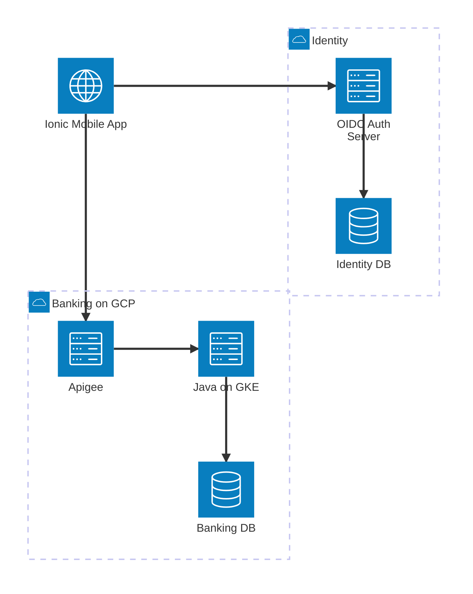
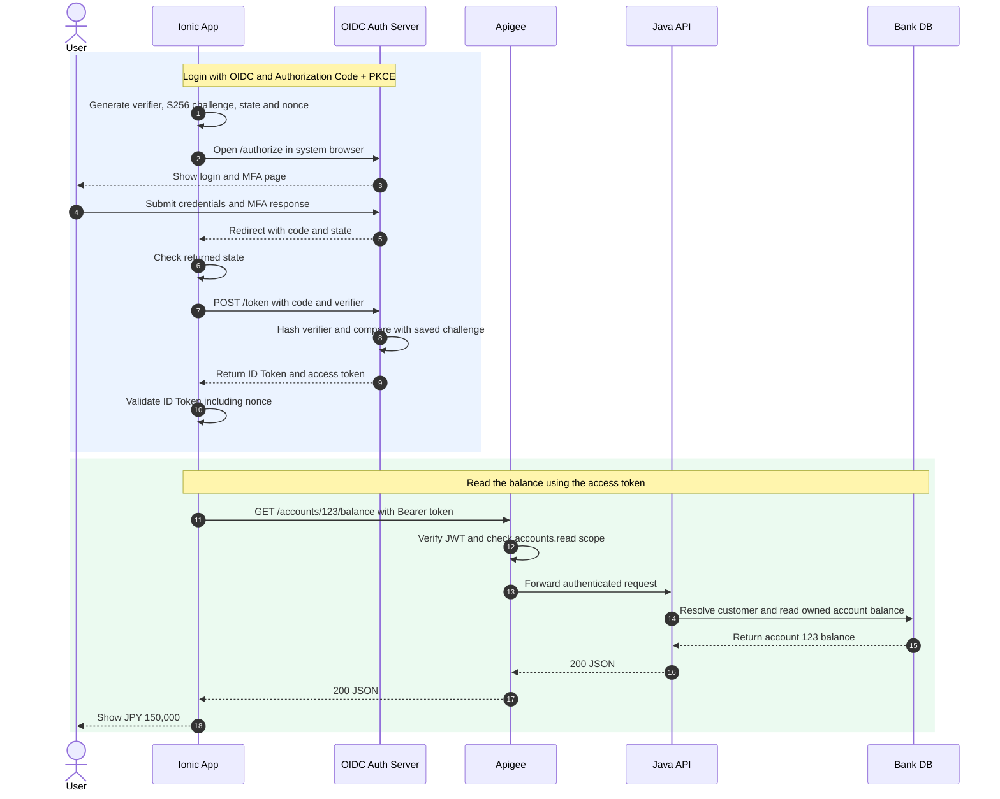

I keep hearing these magic words at work: OAuth, OIDC, SAML, JWT, PKCE. Sometimes they all turn up in the same meeting, and it's easy to lose track of which one does what. So I'm keeping a note here to make sense of the common ones and how they fit together.

## 1. Popular standards and providers

| Standard                  | Main purpose                       | What it standardizes                               | Typical use                       | Example providers / products                                             |
| ------------------------- | ---------------------------------- | -------------------------------------------------- | --------------------------------- | ------------------------------------------------------------------------ |
| **OAuth 2.0**             | Delegated authorization            | Grants, access tokens, scopes, authorization flows | Mobile app calling a banking API  | Okta, Auth0, Microsoft Entra ID, Amazon Cognito, Keycloak, Ping Identity |
| **OpenID Connect (OIDC)** | Authentication on OAuth 2.0        | ID Token, identity claims, discovery, UserInfo     | Sign in and identify the customer | Okta, Auth0, Microsoft Entra ID, Amazon Cognito, Keycloak, Ping Identity |
| **SAML 2.0**              | Federated authentication / SSO     | XML assertions and identity federation             | Employee login to enterprise apps | Okta, Auth0, Microsoft Entra ID, Keycloak, Ping Identity                 |
| **FIDO2 / WebAuthn**      | Passwordless or MFA authentication | Public-key credentials, challenge-response         | Passkeys, device biometrics       | Okta, Microsoft Entra ID, Keycloak                                       |

## 2. Mobile banking with Ionic/Capacitor + Apigee + Java + GCP

Let's say we're building an Mobile app wrapped with Capacitor. Login opens in the system authentication browser, Apigee is the API gateway, and a Java Spring Boot service runs on GKE. For this example, the identity provider issues JWT access tokens.

### Components



| Component                    | Responsibility                                                  | Data it owns / checks                                              |
| ---------------------------- | --------------------------------------------------------------- | ------------------------------------------------------------------ |
| Mobile (OAuth public client) | Starts login, keeps temporary PKCE verifier, validates ID Token | `client_id`, `state`, `nonce`, tokens                              |
| Auth Server + Identity DB    | Checks credentials/MFA; issues signed tokens                    | User identity, password **hash**, MFA, grants, signing private key |
| Apigee (API gateway)         | Validates **access token** and scopes                           | Trusted issuer, audience, JWKS public keys                         |
| Java Spring Boot             | Enforces account ownership; handles business logic              | `sub` → customer mapping, account permissions                      |
| Banking DB                   | Stores customer/accounts/transactions                           | Never trusts an arbitrary account ID from the app                  |

### End-to-end sequence



### What goes in and what comes out

#### Step 1. The app prepares the login

Before opening the browser, the app creates a PKCE verifier, its challenge, a `state` value and a `nonce`. The verifier stays in the app for now.

**Input:** The registered client settings and fresh random values.

```json
{
  "client_id": "bank-mobile",
  "redirect_uri": "https://login.bank.example/callback",
  "scope": "openid accounts.read"
}
```

**Output:** Temporary login data held by the app. `state-456` and `nonce-789` are short placeholders here.

```json
{
  "code_verifier": "dBjftJeZ4CVP-mB92K27uhbUJU1p1r_wW1gFWFOEjXk",
  "code_challenge": "E9Melhoa2OwvFrEMTJguCHaoeK1t8URWbuGJSstw-cM",
  "code_challenge_method": "S256",
  "state": "state-456",
  "nonce": "nonce-789"
}
```

The `code_challenge` calculation is `BASE64URL(SHA256(ASCII(code_verifier)))`.

#### Step 2. The app opens the authorization page

**Input:** An authorization request. The query parameters are split across lines for readability.

```text
GET https://auth.bank.example/authorize
  ?response_type=code
  &client_id=bank-mobile
  &redirect_uri=https%3A%2F%2Flogin.bank.example%2Fcallback
  &scope=openid%20accounts.read
  &state=state-456
  &nonce=nonce-789
  &code_challenge=E9Melhoa2OwvFrEMTJguCHaoeK1t8URWbuGJSstw-cM
  &code_challenge_method=S256
```

**Output:** The browser shows the provider's login page. The Auth Server keeps the request details, including the challenge, for this login transaction.

```text
Browser: Sign in to Example Bank
Auth Server transaction: client=bank-mobile, challenge=E9Mel...stw-cM,
                         method=S256, state=state-456, nonce=nonce-789
```

#### Step 3. The customer signs in

The provider handles the login screen and any MFA. The Ionic app doesn't need to collect the banking password itself.

**Input:**

```json
{
  "username": "demo.customer",
  "password": "<demo-password>",
  "otp": "<demo-one-time-code>"
}
```

**Output:** The Auth Server identifies the customer and creates a short-lived authorization code tied to the earlier request.

```text
Authenticated subject: user-42
Authorization code: CODE_123
Associated client: bank-mobile
Associated PKCE challenge: E9Mel...stw-cM
```

#### Step 4. The browser returns to the app

**Input:** The successful login transaction and its registered callback address.

```text
code=CODE_123
state=state-456
redirect_uri=https://login.bank.example/callback
```

**Output:** A redirect that opens the app, followed by the app's state check.

```http
HTTP/1.1 302 Found
Location: https://login.bank.example/callback?code=CODE_123&state=state-456
```

#### Step 5. The app exchanges the code for tokens

Now the app sends the original verifier. The Auth Server hashes it and compares the result with the saved challenge.

**Input:** A form-encoded token request.

```http
POST /token HTTP/1.1
Host: auth.bank.example
Content-Type: application/x-www-form-urlencoded

grant_type=authorization_code&client_id=bank-mobile&code=CODE_123&redirect_uri=https%3A%2F%2Flogin.bank.example%2Fcallback&code_verifier=dBjftJeZ4CVP-mB92K27uhbUJU1p1r_wW1gFWFOEjXk
```

**Output:** A token response after those checks pass.

```json
{
  "token_type": "Bearer",
  "expires_in": 900,
  "access_token": "<signed-access-JWT>",
  "id_token": "<signed-ID-JWT>"
}
```

#### Step 6. The app validates the ID Token

This is where the app checks who signed in. An OIDC library handles the signature and claim checks using the provider's trusted configuration and public keys.

**Input:** The ID Token, the app's client settings and the saved nonce.

```json
{
  "iss": "https://auth.bank.example",
  "sub": "user-42",
  "aud": "bank-mobile",
  "nonce": "nonce-789",
  "iat": 1794096000,
  "exp": 1794096900
}
```

**Output:** With a valid signature, matching issuer, audience and nonce, and a check time within the token's validity window:

```json
{
  "signedIn": true,
  "subject": "user-42"
}
```

The Auth Server holds the private signing key. The app uses the corresponding public key, found through the trusted provider's discovery document and `jwks_uri`.

#### Step 7. The app asks Apigee for the balance

**Input:**

```json
{ "selectedAccountId": "123", "access_token": "<signed-access-JWT>" }
```

**Output:**

```http
GET /accounts/123/balance HTTP/1.1
Host: api.bank.example
Authorization: Bearer <signed-access-JWT>
```

#### Step 8. Apigee checks the access token

**Input:** The bearer token from step 7. Its decoded payload looks like this:

```json
{
  "iss": "https://auth.bank.example",
  "sub": "user-42",
  "aud": "bank-api",
  "scope": "accounts.read",
  "iat": 1794096000,
  "exp": 1794096900
}
```

**Output:** After verification at a time within that validity window, Apigee forwards the request to Java over the protected backend connection.

```http
GET /accounts/123/balance
Authorization: Bearer <signed-access-JWT>
```

#### Step 9. Java looks up the customer's account

**Input:**

```json
{ "subject": "user-42", "accountId": "123" }
```

For this example, the customer mapping is `user-42 → C9001`. The database lookup uses both `customer_id = C9001` and `account_id = 123`.

**Output:** The matching banking record.

```json
{
  "customerId": "C9001",
  "accountId": "123",
  "currency": "JPY",
  "balance": 150000
}
```

#### Step 10. The balance comes back to the screen

**Input:**

```json
{ "accountId": "123", "currency": "JPY", "balance": 150000 }
```

**Output:**

```http
HTTP/1.1 200 OK
Content-Type: application/json

{ "accountId": "123", "currency": "JPY", "balance": 150000 }
```

### Sumamry

Sign in with the identity provider, get tokens, then follow the access token through the gateway to the banking service.

### References

- [OAuth Security BCP (RFC 9700)](https://www.rfc-editor.org/rfc/rfc9700.html)
- [OAuth for Native Apps (RFC 8252)](https://www.rfc-editor.org/rfc/rfc8252.html)
- [PKCE (RFC 7636)](https://www.rfc-editor.org/rfc/rfc7636.html)
- [OpenID Connect Core](https://openid.net/specs/openid-connect-core-1_0.html)
- [Apigee VerifyJWT policy](https://cloud.google.com/apigee/docs/api-platform/reference/policies/verify-jwt-policy)
- [Mermaid sequence diagrams](https://mermaid.js.org/syntax/sequenceDiagram.html)
