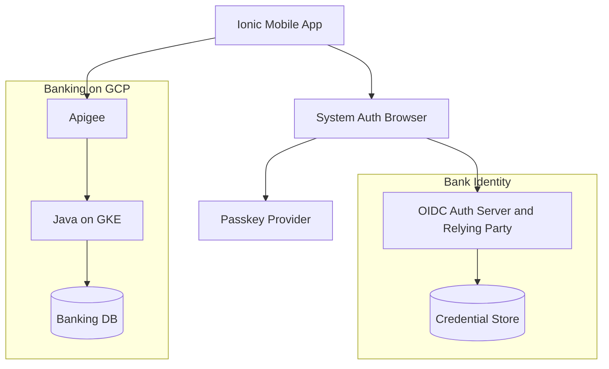
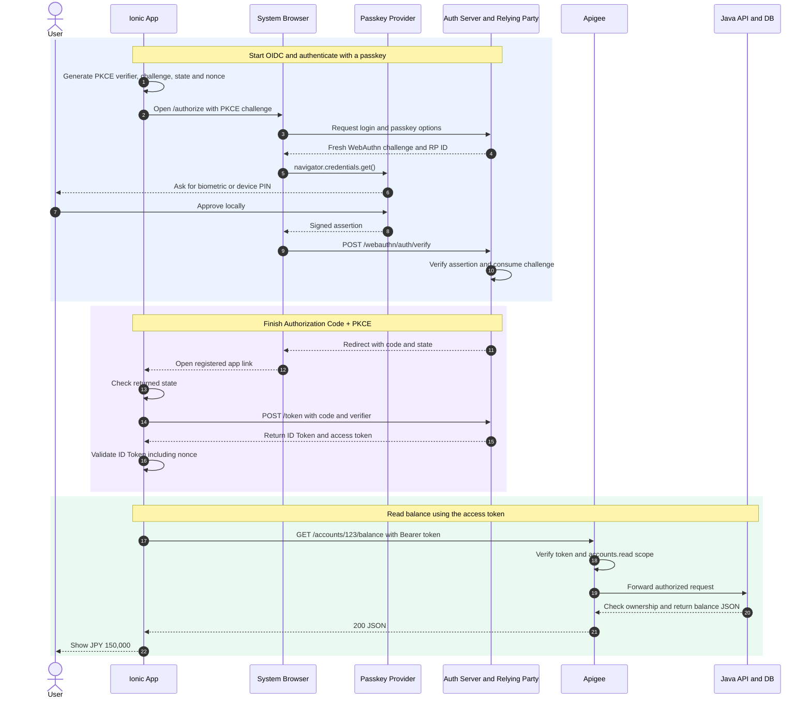

## 1. Popular standards and providers

| Standard                  | Main purpose                       | What it standardizes                               |
| ------------------------- | ---------------------------------- | -------------------------------------------------- |
| **OAuth 2.0**             | Delegated authorization            | Grants, access tokens, scopes, authorization flows |
| **OpenID Connect (OIDC)** | Authentication on OAuth 2.0        | ID Token, identity claims, discovery, UserInfo     |
| **SAML 2.0**              | Federated authentication / SSO     | XML assertions and identity federation             |
| **FIDO2 / WebAuthn**      | Passwordless or MFA authentication | Public-key credentials, challenge-response         |

## 2. Mobile banking with Ionic/Capacitor + WebAuthn + Apigee + Java + GCP

A passkey is a public/private key credential. The bank stores the **public key**; the passkey provider protects the **private key**. Face ID, Touch ID, or a device PIN approves its use locally. The bank receives a signed response, without receiving biometric data.

**WebAuthn** handles that authentication. **OIDC + PKCE** gives the app its identity and access tokens.

### Components



| Component                        | Responsibility                                                                   |
| -------------------------------- | -------------------------------------------------------------------------------- |
| Ionic app + system browser       | Starts OIDC + PKCE and opens the bank's HTTPS login page                         |
| Passkey provider / authenticator | Verifies the user locally and signs with the private key                         |
| Auth Server + Credential Store   | Acts as the WebAuthn Relying Party (RP), verifies credentials, and issues tokens |
| Apigee                           | Validates the access token and scopes                                            |
| Java Spring Boot + Banking DB    | Checks account ownership and returns the balance                                 |

### End-to-end sequence



### What goes in and comes out

#### Steps 1–3. Open the bank's login page

The app creates fresh PKCE, `state`, and `nonce` values, then opens the system browser. The verifier stays in the app.

**Input — authorization request:** Query parameters are split across lines for readability.

```text
GET https://auth.bank.example/authorize
  ?response_type=code
  &client_id=bank-mobile
  &redirect_uri=https%3A%2F%2Flogin.bank.example%2Fcallback
  &scope=openid%20accounts.read
  &state=state-456
  &nonce=nonce-789
  &code_challenge=E9Melhoa2OwvFrEMTJguCHaoeK1t8URWbuGJSstw-cM
  &code_challenge_method=S256
```

**Output:** The bank's login page. When the customer chooses **Sign in with passkey**, the page requests authentication options.

#### Steps 4–8. Approve the passkey on the device

**Input — JSON options from the Auth Server:** The server saves this fresh challenge against the browser's login transaction. It is separate from the PKCE challenge.

```json
{
  "challenge": "rnOv-1ucVCED7a2vF9JUqYBtYFpi-LP-bqBnjv2_oAY",
  "rpId": "auth.bank.example",
  "userVerification": "required",
  "allowCredentials": []
}
```

The empty credential list lets the customer choose a discoverable passkey without first entering a username. The page converts the JSON options and calls `navigator.credentials.get()`.

**Output — abbreviated assertion:** After local approval, the authenticator returns a signature and supporting data to the browser.

```json
{
  "id": "Y3JlZC1hYmMxMjM",
  "type": "public-key",
  "response": {
    "clientDataJSON": "<base64url-client-data>",
    "authenticatorData": "<base64url-authenticator-data>",
    "signature": "<base64url-signature>",
    "userHandle": "dXNlci00Mg"
  }
}
```

The signature covers `authenticatorData || SHA256(clientDataJSON bytes)`. Together, those fields bind the response to the challenge, origin, RP ID, and local verification result.

#### Steps 9–10. Verify the assertion

**Input:** The browser posts the assertion to `/webauthn/auth/verify`. The Auth Server loads the stored public key and expected login context.

**Output — internal authenticated identity:**

```json
{ "authenticated": true, "subject": "user-42", "method": "passkey" }
```

The customer is now authenticated, so the Auth Server can finish the pending OIDC request.

#### Steps 11–16. Return to the app and get tokens

**Input — HTTP redirect:** The registered HTTPS app link opens the mobile app, which checks the returned `state`.

```http
HTTP/1.1 302 Found
Location: https://login.bank.example/callback?code=CODE_123&state=state-456
```

The app exchanges the code at `/token` with its original `code_verifier`, client ID, and matching redirect URI. The Auth Server checks the code and PKCE binding.

**Output — JSON:**

```json
{
  "token_type": "Bearer",
  "expires_in": 900,
  "access_token": "<signed-access-JWT>",
  "id_token": "<signed-ID-JWT>"
}
```

The app's OIDC library validates the ID Token's signature, issuer, audience, expiry, and saved nonce. This is the same token flow as the [OAuth/OIDC guide](/blog/oauth-oidc-mobile-banking-guide); only the customer's authentication method changed.

#### Steps 17–22. Read the customer's balance

**Input — HTTP:**

```http
GET /accounts/123/balance HTTP/1.1
Host: api.bank.example
Authorization: Bearer <signed-access-JWT>
```

Apigee checks the token's signature, issuer, audience, expiry, and `accounts.read` scope. Java maps the verified subject `user-42` to customer `C9001` and confirms that account `123` belongs to that customer.

**Output — HTTP with JSON body:**

```http
HTTP/1.1 200 OK
Content-Type: application/json

{ "accountId": "123", "currency": "JPY", "balance": 150000 }
```

### Summary

The passkey proves who is signing in, OIDC + PKCE gives the app tokens, and the access token carries later API requests through Apigee. Java still checks which accounts the customer can access.

### References

- [W3C Web Authentication Level 3](https://www.w3.org/TR/webauthn-3/)
- [Google: Server-side passkey registration](https://developers.google.com/identity/passkeys/developer-guides/server-registration)
- [Google: Server-side passkey authentication](https://developers.google.com/identity/passkeys/developer-guides/server-authentication)
- [OAuth for Native Apps (RFC 8252)](https://www.rfc-editor.org/rfc/rfc8252.html)
- [OAuth Security BCP (RFC 9700)](https://www.rfc-editor.org/rfc/rfc9700.html)
