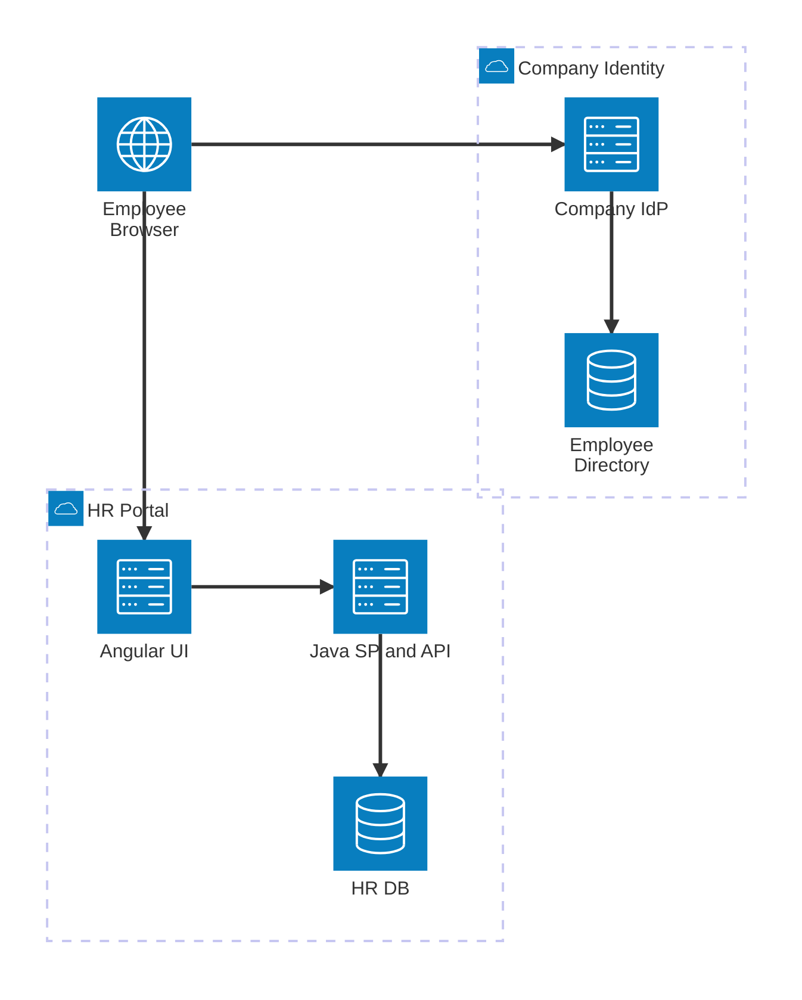
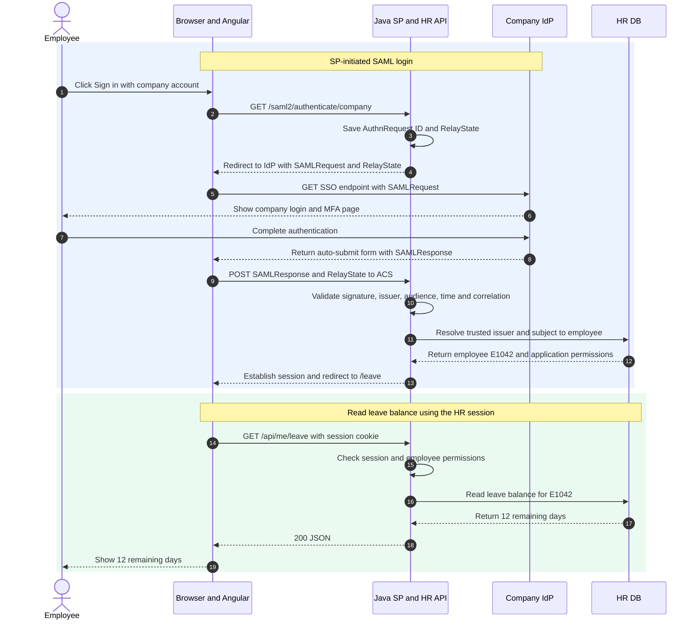

I keep hearing these magic words at work: OAuth, OIDC, SAML, JWT, PKCE. Sometimes they all turn up in the same meeting, and it's easy to lose track of which one does what. So I'm keeping a note here to make sense of the common ones and how they fit together.

## 1. Popular standards and providers

| Standard                  | Main purpose                       | What it standardizes                               |
| ------------------------- | ---------------------------------- | -------------------------------------------------- |
| **OAuth 2.0**             | Delegated authorization            | Grants, access tokens, scopes, authorization flows |
| **OpenID Connect (OIDC)** | Authentication on OAuth 2.0        | ID Token, identity claims, discovery, UserInfo     |
| **SAML 2.0**              | Federated authentication / SSO     | XML assertions and identity federation             |
| **FIDO2 / WebAuthn**      | Passwordless or MFA authentication | Public-key credentials, challenge-response         |

## 2. Enterprise HR portal with Angular + Java Spring Boot + SAML 2.0

Let's say we're building an HR portal where employees check their remaining leave. The company already has an identity provider, and employees use their company accounts to sign in. Our portal trusts that provider instead of keeping another set of passwords.

This is a common setting for SAML: enterprise web apps such as HR portals, ERP systems, CRM tools, and internal admin sites. The company's identity provider might be Microsoft Entra ID, Okta, or another SAML provider. Microsoft's [SAML architecture overview](https://learn.microsoft.com/en-us/entra/architecture/auth-saml) describes this enterprise SSO use case.

For this example, Angular and the Java backend are served under `https://hr.example.com`. Java is the **Service Provider (SP)**, and the company login service is the **Identity Provider (IdP)**. We use an SP-initiated login: the employee starts at the HR portal, which sends them to the IdP.

### Components



| Component               | Responsibility                                                                    |
| ----------------------- | --------------------------------------------------------------------------------- |
| Browser + Angular UI    | Navigates through login and calls the HR API with a session cookie                |
| Company IdP + Directory | Authenticates the employee, applies MFA policy, and signs the SAML assertion      |
| Java Spring Boot (SP)   | Starts SAML login, validates the response, and establishes an application session |
| HR DB                   | Maps the federated identity to an employee and stores leave records               |

Before login works, the administrators configure trust on both sides. The IdP knows the SP's **entity ID** and **Assertion Consumer Service (ACS) URL**. The SP knows the IdP's entity ID, SSO endpoint, and trusted signing certificate from verified metadata. An entity ID identifies a party; it doesn't have to be a page a browser can visit.

```text
SP entity ID: https://hr.example.com/saml/metadata
SP ACS URL:  https://hr.example.com/login/saml2/sso/company
IdP entity ID: https://login.company.example/saml/metadata
IdP SSO URL:   https://login.company.example/saml/sso
```

### End-to-end sequence



### What goes in and what comes out

The step numbers match the numbered arrows in the sequence diagram. The XML and HTTP examples are shortened for readability. The signatures, encoded messages, and session values are placeholders, not working credentials.

#### Steps 1–3. The employee starts login

The sign-in button navigates the browser to Java. Java creates an `AuthnRequest` and remembers its ID so it can match the response to this login attempt. It also creates an opaque `RelayState` value mapped to the intended local destination.

**Input:** The configured company SAML registration and the page the employee wants to open.

```json
{
  "registrationId": "company",
  "returnTo": "/leave"
}
```

**Output:** An authentication request and temporary server-side login state.

```xml
<samlp:AuthnRequest
    xmlns:samlp="urn:oasis:names:tc:SAML:2.0:protocol"
    xmlns:saml="urn:oasis:names:tc:SAML:2.0:assertion"
    ID="_request123"
    Version="2.0"
    IssueInstant="2026-11-10T09:00:00Z"
    Destination="https://login.company.example/saml/sso"
    AssertionConsumerServiceURL="https://hr.example.com/login/saml2/sso/company"
    ProtocolBinding="urn:oasis:names:tc:SAML:2.0:bindings:HTTP-POST">
  <saml:Issuer>https://hr.example.com/saml/metadata</saml:Issuer>
</samlp:AuthnRequest>
```

```json
{
  "requestId": "_request123",
  "relayState": "relay-456",
  "returnTo": "/leave"
}
```

Here, `company` is a local Spring Security registration ID. The SAML entity IDs identify the SP and IdP across the federation.

#### Steps 4–5. The browser takes the request to the IdP

This example uses the HTTP-Redirect binding for the request. The SAML library DEFLATE-compresses the XML, Base64-encodes it, then URL-encodes the result. If the registration requires signed requests, it also signs the redirect query according to that binding.

**Input:** The `AuthnRequest`, IdP SSO URL, and saved `RelayState`.

**Output:** A redirect followed by a browser request to the company login service. The URL is split across lines for readability.

```http
HTTP/1.1 302 Found
Location: https://login.company.example/saml/sso
  ?SAMLRequest=<url-encoded-base64-deflated-XML>
  &RelayState=relay-456
```

`RelayState` helps restore the destination after login. The SP checks it against its saved state and redirects only to an allowed local path.

#### Steps 6–7. The employee signs in at the company IdP

The IdP validates the request against the registered SP and handles authentication. The portal doesn't collect the company password.

**Input:** The login interaction on the IdP's own page, for example:

```text
Company account: demo.employee@company.example
Password: <entered only on the IdP page>
MFA: <completed according to company policy>
```

**Output:** An authenticated identity at the IdP.

```json
{
  "subject": "employee-42",
  "authenticated": true,
  "requestId": "_request123"
}
```

If an acceptable IdP session already exists, the provider may complete this without asking for the password again. That's what makes opening another federated app feel like single sign-on; company policy can still require fresh authentication or MFA.

#### Steps 8–9. The browser posts the SAML response to Java

The IdP creates a SAML response containing an assertion about the employee. In this example it signs the assertion with its private key and sends the browser an auto-submitting HTML form targeting the registered ACS URL.

**Input:** The authenticated employee, the original request, and the configured attribute mappings.

Below is a shortened decoded response. The `ds:Signature` comment represents a real XML signature that a library must verify; this sample is not a complete, verifiable response.

```xml
<samlp:Response
    xmlns:samlp="urn:oasis:names:tc:SAML:2.0:protocol"
    xmlns:saml="urn:oasis:names:tc:SAML:2.0:assertion"
    xmlns:ds="http://www.w3.org/2000/09/xmldsig#"
    ID="_response789"
    Version="2.0"
    IssueInstant="2026-11-10T09:01:00Z"
    InResponseTo="_request123"
    Destination="https://hr.example.com/login/saml2/sso/company">
  <saml:Issuer>https://login.company.example/saml/metadata</saml:Issuer>
  <samlp:Status>
    <samlp:StatusCode Value="urn:oasis:names:tc:SAML:2.0:status:Success" />
  </samlp:Status>
  <saml:Assertion ID="_assertion789" Version="2.0"
      IssueInstant="2026-11-10T09:01:00Z">
    <saml:Issuer>https://login.company.example/saml/metadata</saml:Issuer>
    <!-- ds:Signature over this assertion omitted -->
    <saml:Subject>
      <saml:NameID Format="urn:oasis:names:tc:SAML:2.0:nameid-format:persistent">employee-42</saml:NameID>
      <saml:SubjectConfirmation Method="urn:oasis:names:tc:SAML:2.0:cm:bearer">
        <saml:SubjectConfirmationData
            InResponseTo="_request123"
            Recipient="https://hr.example.com/login/saml2/sso/company"
            NotOnOrAfter="2026-11-10T09:06:00Z" />
      </saml:SubjectConfirmation>
    </saml:Subject>
    <saml:Conditions NotBefore="2026-11-10T09:00:30Z"
        NotOnOrAfter="2026-11-10T09:06:00Z">
      <saml:AudienceRestriction>
        <saml:Audience>https://hr.example.com/saml/metadata</saml:Audience>
      </saml:AudienceRestriction>
    </saml:Conditions>
    <saml:AuthnStatement AuthnInstant="2026-11-10T09:00:50Z">
      <saml:AuthnContext>
        <saml:AuthnContextClassRef>urn:oasis:names:tc:SAML:2.0:ac:classes:PasswordProtectedTransport</saml:AuthnContextClassRef>
      </saml:AuthnContext>
    </saml:AuthnStatement>
    <saml:AttributeStatement>
      <saml:Attribute Name="email">
        <saml:AttributeValue>demo.employee@company.example</saml:AttributeValue>
      </saml:Attribute>
    </saml:AttributeStatement>
  </saml:Assertion>
</samlp:Response>
```

The authentication context here illustrates a password-based login over a protected connection. SAML does not make MFA mandatory; the IdP policy and agreed context determine what authentication is required.

**Output:** The browser submits the form as an HTTP POST. For this binding, `SAMLResponse` is the Base64-encoded XML, then form-encoded; it isn't DEFLATE-compressed like the redirect request above.

```http
POST /login/saml2/sso/company HTTP/1.1
Host: hr.example.com
Content-Type: application/x-www-form-urlencoded

SAMLResponse=<form-encoded-base64-response-XML>&RelayState=relay-456
```

The browser carries the message between the two systems. Java uses the IdP's trusted public signing certificate to check the assertion. Base64 is encoding, so HTTPS still matters; assertion encryption is a separate SAML feature.

#### Step 10. Java validates the response and assertion

**Input:** The posted message, the saved login request, and the configured trust information.

```json
{
  "expectedIssuer": "https://login.company.example/saml/metadata",
  "expectedAudience": "https://hr.example.com/saml/metadata",
  "expectedRecipient": "https://hr.example.com/login/saml2/sso/company",
  "expectedRequestId": "_request123",
  "checkTime": "2026-11-10T09:01:05Z"
}
```

The SP verifies the trusted signature and consumes the assertion covered by it. It checks success status, issuer, audience, destination, recipient, validity windows, and `InResponseTo` correlation with the outstanding request. This SP-initiated design rejects unsolicited responses and reused login responses, with consumed request state and replay tracking as needed.

I would use Spring Security's SAML support for parsing and validation, then verify the application's correlation and replay behavior. XML signature handling is too easy to get wrong with a hand-written parser. Spring's [login overview](https://docs.spring.io/spring-security/reference/servlet/saml2/login/overview.html) shows where this authentication happens.

**Output:** A verified federated identity, ready for local employee mapping.

```json
{
  "authenticated": true,
  "issuer": "https://login.company.example/saml/metadata",
  "subject": "employee-42",
  "email": "demo.employee@company.example"
}
```

#### Steps 11–13. Java maps the identity and establishes an HR session

**Input:** The trusted issuer and subject. We use that pair as the identity key rather than treating a changeable email address as the employee ID.

```text
(https://login.company.example/saml/metadata, employee-42) → E1042
```

**Output:** The database returns an active employee and locally assigned permissions. Java rotates the session ID after authentication and redirects the browser to the saved destination.

```json
{
  "employeeId": "E1042",
  "active": true,
  "permissions": ["leave.read.self"]
}
```

```http
HTTP/1.1 302 Found
Set-Cookie: __Host-HRSESSION=<opaque-session-id>; Path=/; Secure; HttpOnly; SameSite=Lax
Location: /leave
```

This is the application's post-login session cookie, not a SAML requirement. Because the ACS receives a cross-site POST, the temporary login-state mechanism must also work on that callback. A separate short-lived correlation cookie may need `SameSite=None; Secure`, depending on the deployment; a `Lax` cookie generally won't accompany that POST. The app also needs CSRF protection for state-changing session-authenticated API calls, with SAML-specific handling for the ACS.

#### Steps 14–17. The portal requests the employee's leave balance

**Input:** Angular calls the same-origin API. The browser attaches the HR session cookie automatically; JavaScript doesn't read the `HttpOnly` cookie.

```http
GET /api/me/leave HTTP/1.1
Host: hr.example.com
Cookie: __Host-HRSESSION=<opaque-session-id>
```

Java resolves `E1042` from the server-side session and checks `leave.read.self`. The database query uses that employee ID rather than trusting an arbitrary employee ID supplied by the browser.

**Output:** The matching HR record.

```json
{
  "employeeId": "E1042",
  "remainingDays": 12,
  "year": 2026
}
```

The SAML assertion authenticated the employee. The HR application still decides which records that employee can access.

#### Steps 18–19. The leave balance comes back to the screen

**Input:** The employee's leave record.

**Output:** An API response that Angular displays as “12 days remaining.”

```http
HTTP/1.1 200 OK
Content-Type: application/json

{ "employeeId": "E1042", "remainingDays": 12, "year": 2026 }
```

The browser now uses the HR session for requests. It doesn't attach the SAML XML to every API call. Opening another app that trusts the same IdP starts a separate SAML exchange and creates that app's own session, often reusing the existing company login. Logging out of HR alone doesn't necessarily end the IdP session or the sessions in other apps.

### Summary

The company IdP signs an assertion about the employee. Java validates it, maps the employee to a local account, and establishes an HR session. Once I separate the company login from the portal's own session and permissions, the flow is much easier to follow.

### References

- [OASIS SAML 2.0 Technical Overview](https://docs.oasis-open.org/security/saml/Post2.0/sstc-saml-tech-overview-2.0.html)
- [OASIS SAML 2.0 Core](https://docs.oasis-open.org/security/saml/v2.0/saml-core-2.0-os.pdf)
- [OASIS SAML 2.0 Bindings](https://docs.oasis-open.org/security/saml/v2.0/saml-bindings-2.0-os.pdf)
- [OASIS SAML 2.0 Profiles](https://docs.oasis-open.org/security/saml/v2.0/saml-profiles-2.0-os.pdf)
- [Microsoft Entra SAML architecture](https://learn.microsoft.com/en-us/entra/architecture/auth-saml)
- [Spring Security SAML 2.0 Login](https://docs.spring.io/spring-security/reference/servlet/saml2/login/overview.html)
