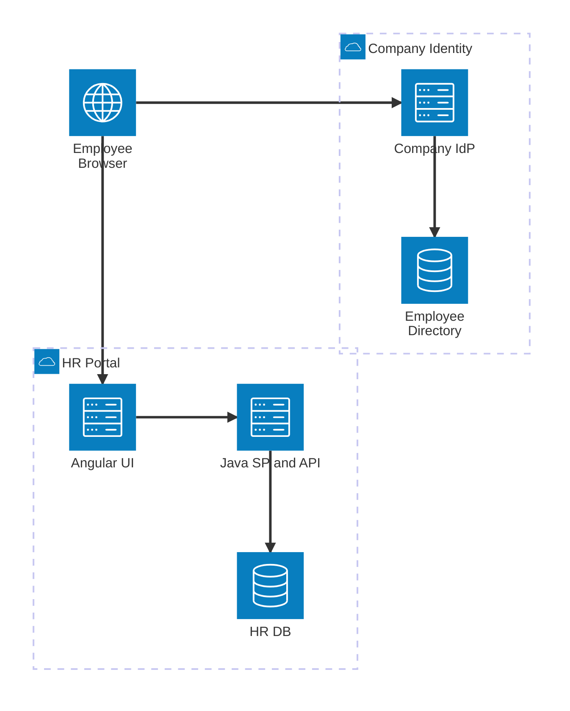
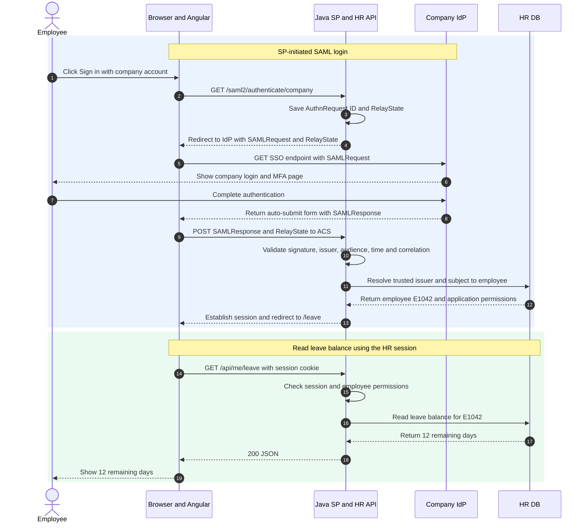

I keep hearing the same acronyms at work: OAuth, OIDC, SAML, JWT, PKCE. Sometimes they all come up in the same meeting, and it's easy to lose track of which one does what. So I put together this note to make sense of the common ones and how they fit together.

## 1. Popular standards and providers

| Standard                  | Main purpose                       | What it standardizes                               |
| ------------------------- | ---------------------------------- | -------------------------------------------------- |
| **OAuth 2.0**             | Delegated authorization            | Grants, access tokens, scopes, authorization flows |
| **OpenID Connect (OIDC)** | Authentication on OAuth 2.0        | ID Token, identity claims, discovery, UserInfo     |
| **SAML 2.0**              | Federated authentication / SSO     | XML assertions and identity federation             |
| **FIDO2 / WebAuthn**      | Passwordless or MFA authentication | Public-key credentials, challenge-response         |

## 2. Enterprise HR portal with Angular + Java Spring Boot + SAML 2.0

Let's say we're building an HR portal where employees check their remaining leave. Java is the **Service Provider (SP)**, and the company login service is the **Identity Provider (IdP)**.

### Components



| Component               | Responsibility                                                                    |
| ----------------------- | --------------------------------------------------------------------------------- |
| Browser + Angular UI    | Navigates through login and calls the HR API with a session cookie                |
| Company IdP + Directory | Authenticates the employee, applies MFA policy, and signs the SAML assertion      |
| Java Spring Boot (SP)   | Starts SAML login, validates the response, and establishes an application session |
| HR DB                   | Maps the federated identity to an employee and stores leave records               |

Administrators configure trust on both sides: the IdP knows the SP's **entity ID** and **Assertion Consumer Service (ACS) URL**, while the SP knows the IdP's entity ID, SSO endpoint, and trusted signing certificate from verified metadata. An entity ID identifies a party and doesn't have to point to a page a browser can visit.

```text
SP entity ID: https://hr.example.com/saml/metadata
SP ACS URL:  https://hr.example.com/login/saml2/sso/company
IdP entity ID: https://login.company.example/saml/metadata
IdP SSO URL:   https://login.company.example/saml/sso
```

### End-to-end sequence



### What goes in and what comes out

#### Steps 1–5. Start login and redirect to the IdP

**Input — HTTP:** The sign-in button opens Spring Security's login endpoint.

```http
GET /saml2/authenticate/company HTTP/1.1
Host: hr.example.com
```

**Output — XML:** Java creates an `AuthnRequest`. This excerpt shows who is requesting login and where the response should go; other required fields and namespace declarations are omitted.

```xml
<samlp:AuthnRequest
    ID="_request123"
    Destination="https://login.company.example/saml/sso"
    AssertionConsumerServiceURL="https://hr.example.com/login/saml2/sso/company">
  <saml:Issuer>https://hr.example.com/saml/metadata</saml:Issuer>
</samlp:AuthnRequest>
```

**Output — HTTP:** Java saves the request ID and redirects the browser. `SAMLRequest` contains the compressed, Base64-encoded, then URL-encoded XML. `RelayState` is an opaque value mapped to `/leave` on the server.

```http
HTTP/1.1 302 Found
Location: https://login.company.example/saml/sso?SAMLRequest=<encoded-XML>&RelayState=relay-456
```

#### Steps 8–9. Return the SAML response

**Input — XML:** After login, the IdP creates a response containing a signed assertion. This decoded excerpt shows the subject, intended application, request correlation, and expiry; namespaces, the signature, and other required fields are omitted.

```xml
<samlp:Response
    InResponseTo="_request123"
    Destination="https://hr.example.com/login/saml2/sso/company">
  <saml:Assertion>
    <saml:Issuer>https://login.company.example/saml/metadata</saml:Issuer>
    <!-- Signature covering this assertion omitted -->
    <saml:Subject>
      <saml:NameID>employee-42</saml:NameID>
    </saml:Subject>
    <saml:Conditions NotOnOrAfter="2026-11-10T09:06:00Z">
      <saml:AudienceRestriction>
        <saml:Audience>https://hr.example.com/saml/metadata</saml:Audience>
      </saml:AudienceRestriction>
    </saml:Conditions>
  </saml:Assertion>
</samlp:Response>
```

**Output — HTTP:** The IdP sends an auto-submitting form to the browser, which posts it to the ACS. `SAMLResponse` contains Base64-encoded XML, then form-encoded for transport.

```http
POST /login/saml2/sso/company HTTP/1.1
Host: hr.example.com
Content-Type: application/x-www-form-urlencoded

SAMLResponse=<encoded-XML>&RelayState=relay-456
```

#### Step 10. Validate the response and assertion

**Input — validation context (illustrative text):** Java checks the posted XML against its trusted configuration and saved request.

```text
Trusted issuer:    https://login.company.example/saml/metadata
Expected audience: https://hr.example.com/saml/metadata
Expected ACS:      https://hr.example.com/login/saml2/sso/company
Saved request ID:  _request123
Check time:        2026-11-10T09:01:05Z
Signing key:       trusted IdP public key from its certificate
```

The backend verifies the signature covering the assertion it uses, then checks success status, issuer, audience, destination, recipient, validity windows, and request correlation.

**Output — verified identity:**

```json
{
  "issuer": "https://login.company.example/saml/metadata",
  "subject": "employee-42",
  "authenticated": true
}
```

#### Steps 11–13. Map the employee and create a session

**Input — identity mapping:**

```text
(https://login.company.example/saml/metadata, employee-42)
  → employeeId: E1042
  → permission: leave.read.self
```

**Output — HTTP:** Java establishes the local session, rotates the session ID, and redirects to the saved page.

```http
HTTP/1.1 302 Found
Set-Cookie: __Host-HRSESSION=<opaque-session-id>; Path=/; Secure; HttpOnly; SameSite=Lax
Location: /leave
```

#### Steps 14–19. Read the leave balance

**Input — HTTP:** Angular calls the API, and the browser attaches the session cookie.

```http
GET /api/me/leave HTTP/1.1
Host: hr.example.com
Cookie: __Host-HRSESSION=<opaque-session-id>
```

Java gets `E1042` from the session, checks `leave.read.self`, and reads that employee's balance.

**Output — HTTP with JSON body:** Angular displays “12 days remaining.”

```http
HTTP/1.1 200 OK
Content-Type: application/json

{ "employeeId": "E1042", "remainingDays": 12, "year": 2026 }
```

### Summary

The IdP proves who signed in; the HR portal maps that identity to an employee and creates its own session. Later API requests use the session cookie, while the backend enforces employee permissions.

### References

- [OASIS SAML 2.0 Technical Overview](https://docs.oasis-open.org/security/saml/Post2.0/sstc-saml-tech-overview-2.0.html)
- [OASIS SAML 2.0 Core](https://docs.oasis-open.org/security/saml/v2.0/saml-core-2.0-os.pdf)
- [OASIS SAML 2.0 Bindings](https://docs.oasis-open.org/security/saml/v2.0/saml-bindings-2.0-os.pdf)
- [OASIS SAML 2.0 Profiles](https://docs.oasis-open.org/security/saml/v2.0/saml-profiles-2.0-os.pdf)
- [Microsoft Entra SAML architecture](https://learn.microsoft.com/en-us/entra/architecture/auth-saml)
- [Spring Security SAML 2.0 Login](https://docs.spring.io/spring-security/reference/servlet/saml2/login/overview.html)
