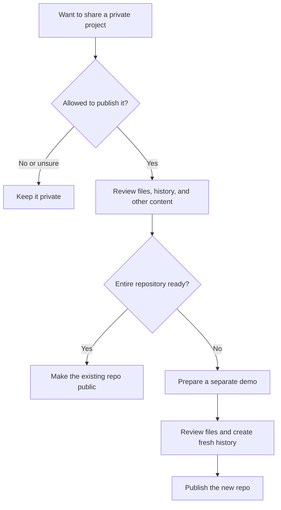

A private project can become worth sharing. Before making it public, I would check what I am
sharing—including its history.

## Public vs private

|                  | Public                                               | Private                                         |
| ---------------- | ---------------------------------------------------- | ----------------------------------------------- |
| Who can read it? | Anyone                                               | People with access                              |
| Main benefit     | Easy to share, show in a portfolio, and get feedback | Control who sees the work                       |
| Good for         | Learning projects, reusable tools, open source       | Experiments, internal tools, confidential work  |
| Collaboration    | Others can discover it and propose changes           | Invite the people you want to work with         |
| Tradeoff         | Published content can be copied and stay available   | Harder to show or share without granting access |

Public read access does not let everyone push changes. Private repositories still support teamwork,
and neither visibility is a good reason to commit secrets.

See GitHub's [repository visibility guide](https://docs.github.com/en/repositories/managing-your-repositorys-settings-and-features/managing-repository-settings/setting-repository-visibility).

## Before going public

| Check         | What I would do                                                                                   |
| ------------- | ------------------------------------------------------------------------------------------------- |
| Ownership     | Confirm I can publish the code and assets, especially employer or client work                     |
| Secrets       | Remove keys, tokens, passwords, and private keys; revoke or rotate any that may have been exposed |
| Personal data | Replace real names, contacts, addresses, and customer records with sample data                    |
| Git history   | Review old commits, branches, and tags—not just current files                                     |
| Other content | Check issues, pull requests, screenshots, releases, and Actions logs                              |
| Configuration | Provide placeholder examples; keep real credentials outside the repository                        |
| License       | Choose reuse permissions and preserve third-party notices                                         |
| Setup         | Try a fresh clone, follow the README, and run the documented checks                               |

Use automated scanning alongside manual review. A scanner may find a token but miss personal
information in a screenshot. Values sent to the browser are readable by visitors, even if they
came from environment variables.

GitHub notes that Actions history and logs become public after the switch. Review its
[visibility guide](https://docs.github.com/en/repositories/managing-your-repositorys-settings-and-features/managing-repository-settings/setting-repository-visibility)
for the current effects on forks and rulesets too.

## Deleting a file does not delete its history

| Action                            | What it leaves behind                      |
| --------------------------------- | ------------------------------------------ |
| Delete a secret in a new commit   | Earlier commits may still contain it       |
| Add a file to `.gitignore`        | Existing tracked files and history remain  |
| Rewrite history                   | Copies in other clones or forks may remain |
| Make the repository private again | Existing public copies are not recalled    |

If a credential may have been exposed, revoke or rotate it first. Removing its text does not
invalidate it. Follow GitHub's
[sensitive data removal guide](https://docs.github.com/en/authentication/keeping-your-account-and-data-secure/removing-sensitive-data-from-a-repository)
for cleanup.

## Publish the existing repo or create a new one?

| Option                                      | When I would choose it                                                  | What to remember                                           |
| ------------------------------------------- | ----------------------------------------------------------------------- | ---------------------------------------------------------- |
| Make the existing repo public               | Its files, history, and other content are ready to share                | Review the whole repository before switching               |
| Create a new public repo with fresh history | I want to share a demo and keep the original development record private | Copy only reviewed files, without the old `.git` directory |

A fresh repository still needs the same file review. It does not remove sensitive data from the
original repository or revoke old credentials.

## Public does not automatically mean open source

| Visibility                          | License                                                       |
| ----------------------------------- | ------------------------------------------------------------- |
| Controls who can see the repository | Defines how others may reuse, modify, and distribute the code |

GitHub allows viewing and forking public repositories under its terms. That is different from
unrestricted reuse. If I want to share an open source project, I would include an appropriate
license. See GitHub's [licensing guide](https://docs.github.com/en/repositories/managing-your-repositorys-settings-and-features/customizing-your-repository/licensing-a-repository).

I would choose public when sharing has a clear purpose, and private when the audience or content
still needs limits. Before switching, I would assume published material can be copied and remain
available elsewhere.
